# Lab 05: Who Can Touch the Mona Lisa? Governance and Security Hardening for a Fictional Art Museum (NIST CSF)

Week 5 of my Azure portfolio. A **fictional** art museum wants to scan and process its collection in the cloud. The question: who is allowed to touch it, what can they build, and what happens if costs run away?

> **Scope note:** fictional scenario, built in a personal Azure subscription, all resources deleted afterward. This is a governance exercise, not a production deployment.

## Walkthrough

## The story

A junior developer joins the museum's digital team. They should be able to **look** at the collection's cloud resources, not change them. Nobody should be able to launch an oversized, expensive VM by accident. And finance wants a warning before the monthly bill gets out of hand.

## NIST CSF mapping

| Function | What I did |
|---|---|
| Identify | Created a user (Junior Developer) in Entra ID |
| Protect | Gave them **Reader** only (RBAC) and applied an Azure Policy restricting VM sizes |
| Detect | Cost budget `Monthly-Museum-Scan-Budget` with actual and forecasted alerts |
| Respond | Alerts go to email so a human can act |
| Recover | Cleaned up: deleted the resource group, policy and user |

## What was built

| Item | Name | Notes |
|---|---|---|
| Resource group | `rg-lab05-gov-jaden` | Scope for everything below |
| Entra user | Junior Developer | Reader on the resource group |
| Policy assignment | `Restrict-VM-Sizes` | Built-in "Allowed virtual machine size SKUs", effect Deny |
| Budget | `Monthly-Museum-Scan-Budget` | Alerts on actual and forecasted spend |

## Evidence

**1. The junior user exists in Entra ID**

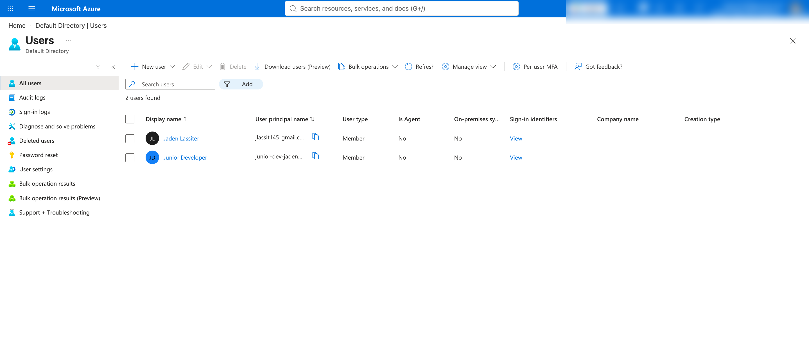

**2. Role assignment: Owner for me, Reader for the junior user**

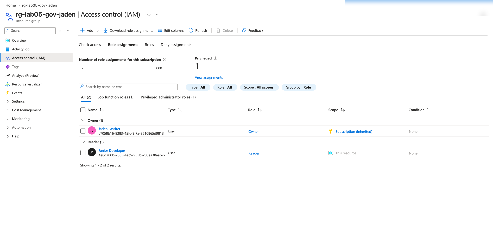

**3. Signed in as the junior user, creating a storage account fails (AuthorizationFailed)**

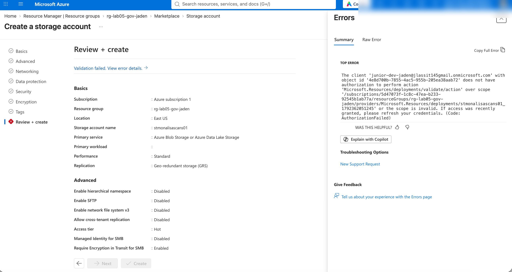

**4. Policy assignment parameters: only approved VM sizes**

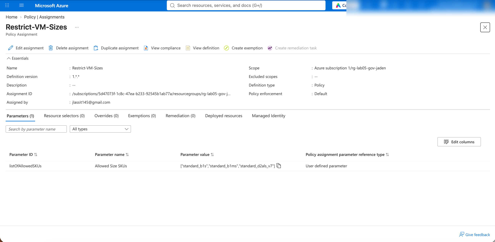

**5. Creating a VM with a disallowed size is blocked by the policy**

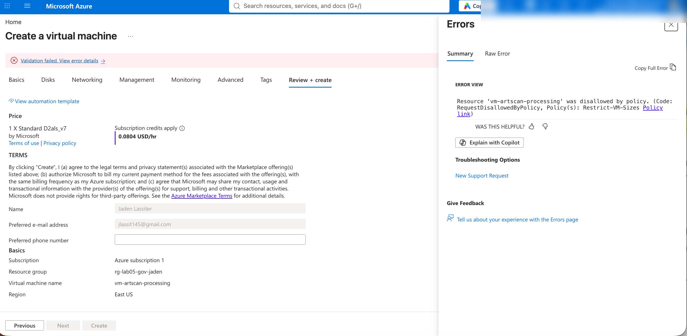

**6. Policy assignments list**

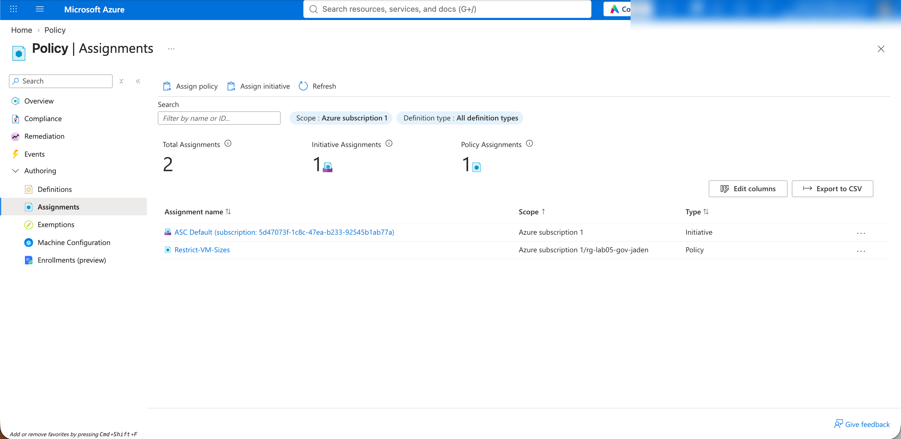

**7. After adding an allowed size to the policy, the same VM form passes (Create enabled)**

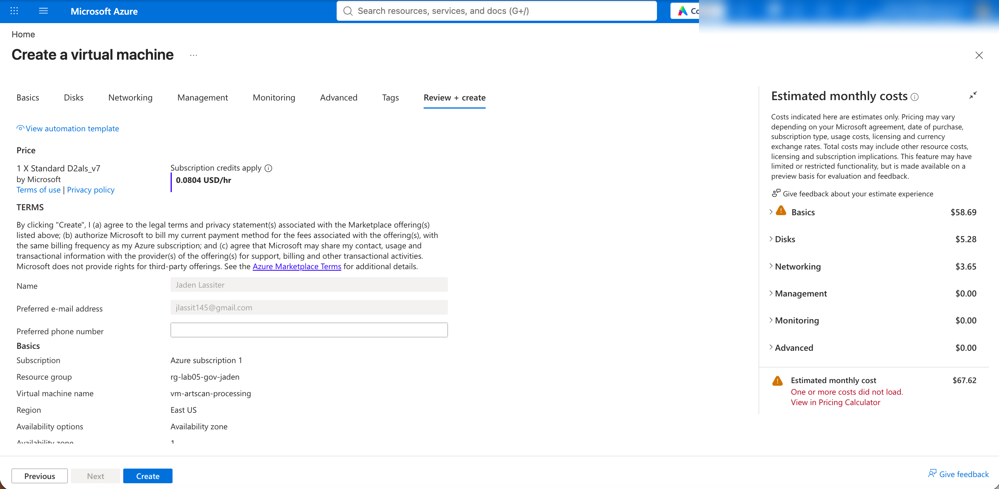

**8. Budget alert conditions**

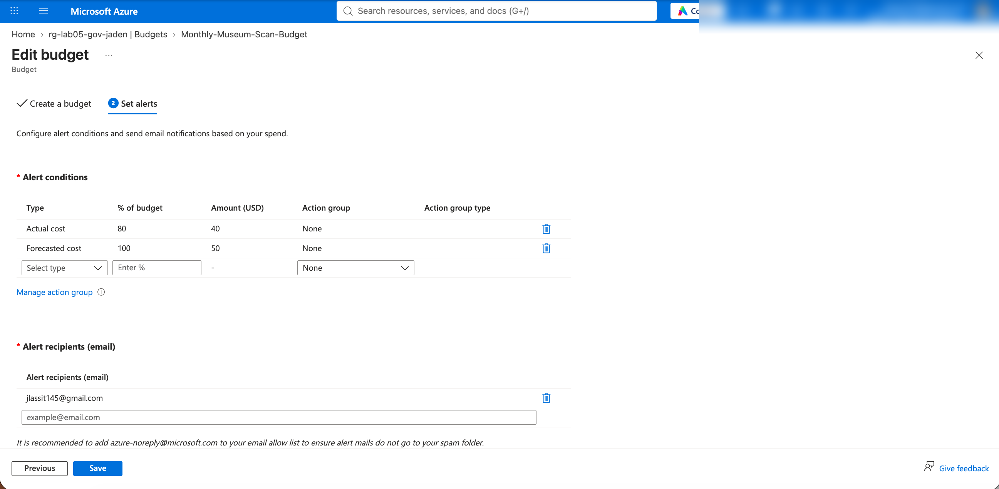

**9. Budget created**

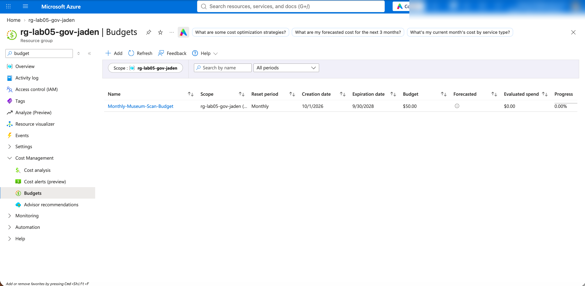

**10. Clean-up: deleting the resource group**

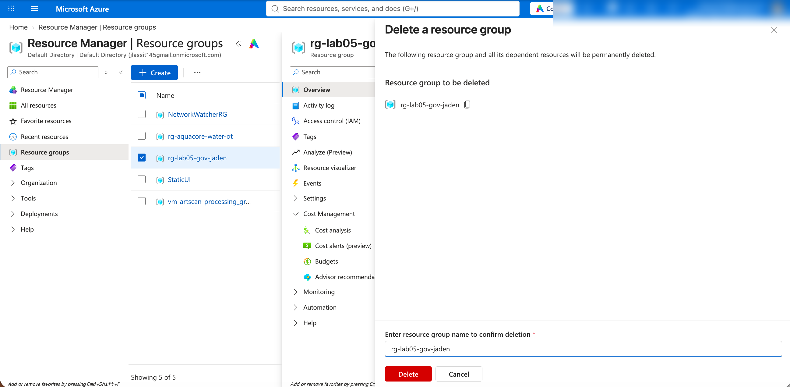

**11. Clean-up: junior user deleted (1 user left)**

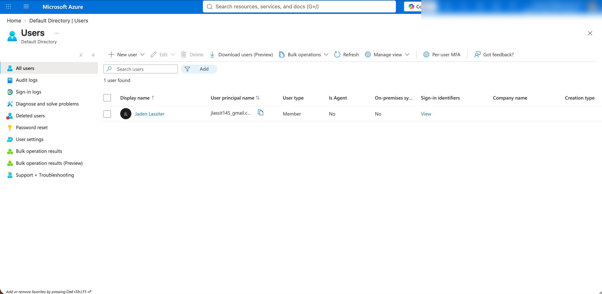

## Key ideas I took away

- Give permissions to **groups**, not individuals. I used one user here to keep the lab small.
- RBAC is who + what + where. Reader at the resource group means look, don't touch.
- A policy *definition* is the rule; an *assignment* applies it to a scope.
- Policy denies at deploy time, and it applies to admins too.
- A budget **alerts**. It does not stop spending.

## Honest notes

- **Typo'd sign-in.** I mistyped the junior user's sign-in name twice before getting it right.
- **Forced password change.** The new user had to set a new password on first sign-in. That is expected behavior for a new account.
- **VM sizes unavailable.** The B-series sizes in the lab and `Standard_D2s_v3` were not available in my subscription and regions. `Standard_D2als_v7` was. I added it to the allowed list so I could show both sides: blocked size, then allowed size.
- **Policy only covers its scope.** The VM form defaulted to a *new* resource group, outside the policy's scope, where the policy would not have applied. I caught it and switched back to `rg-lab05-gov-jaden`. A leftover empty resource group from that form needed cleanup.
- **No green "validation passed" banner** on the final VM review page, but the Create button was enabled and the policy error was gone. I did not create the VM.
- **Propagation delay.** The policy took a while (roughly 10 to 30 minutes) to start enforcing.
- **Everything was deleted** afterward to avoid cost.

## Out of scope

Policy initiatives, custom roles, PIM, Action Groups, remediation tasks, and automated alert responses.
